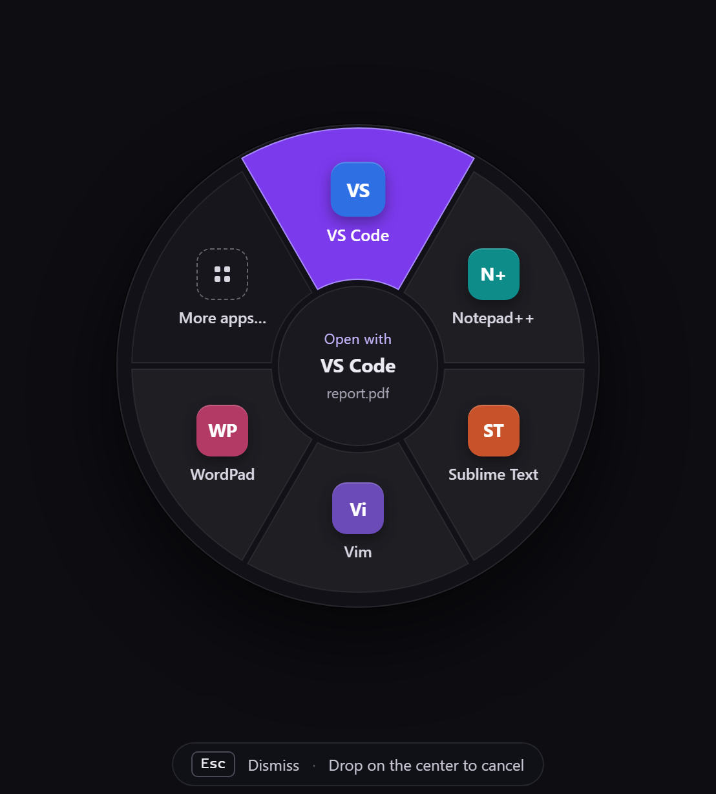
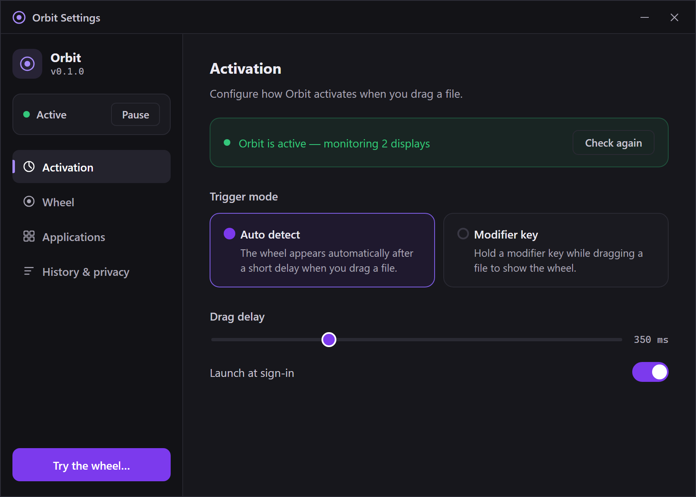
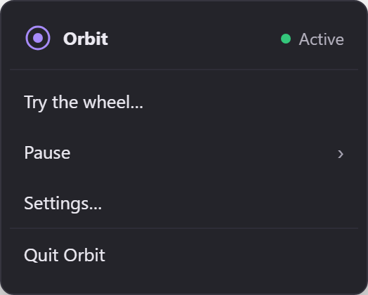

# Orbit

**A radial "Open with" menu for Windows.**

Drag a file out of Explorer, and a wheel appears around your cursor with apps that can open it. Drop on a wedge.

## Screenshots

<table>
<tr>
<td width="50%">

**The wheel** — pops up mid-drag with apps for that file type.



</td>
<td width="50%">

**Settings** — configure activation, wheel size, and per-extension app lists.



</td>
</tr>
<tr>
<td>

**System tray** — pause, open settings, or quit.



</td>

</tr>
</table>

## Install

Download the installer from the [Releases](../../releases) page. Per-user, no admin required.

## Build from source

```bash
git clone https://github.com/dwimbley/Orbit.git
cd Orbit
npm install
npm run rebuild-native   # builds the C++ addon
npm run build            # compiles TypeScript
npm start                # launches the app
```

**Requirements:**
- Node.js 22+
- Visual Studio 2022 (or Build Tools) with the C++ desktop development workload
- Windows 10/11 x64

### Package an installer

```bash
npm run package
# Output: release/Orbit Setup 0.1.0.exe
```

## License

[MIT](LICENSE)
